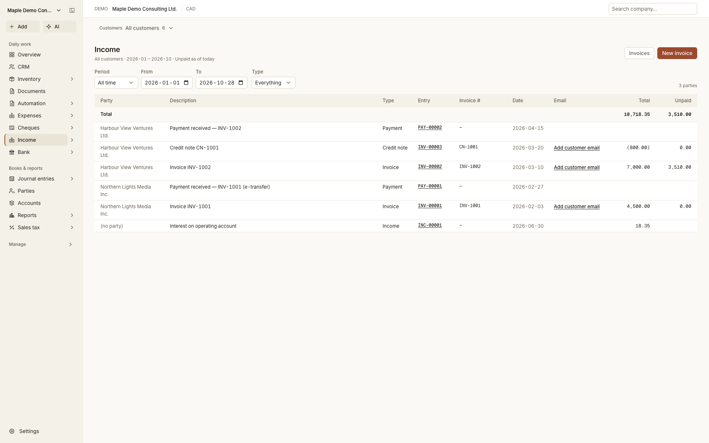
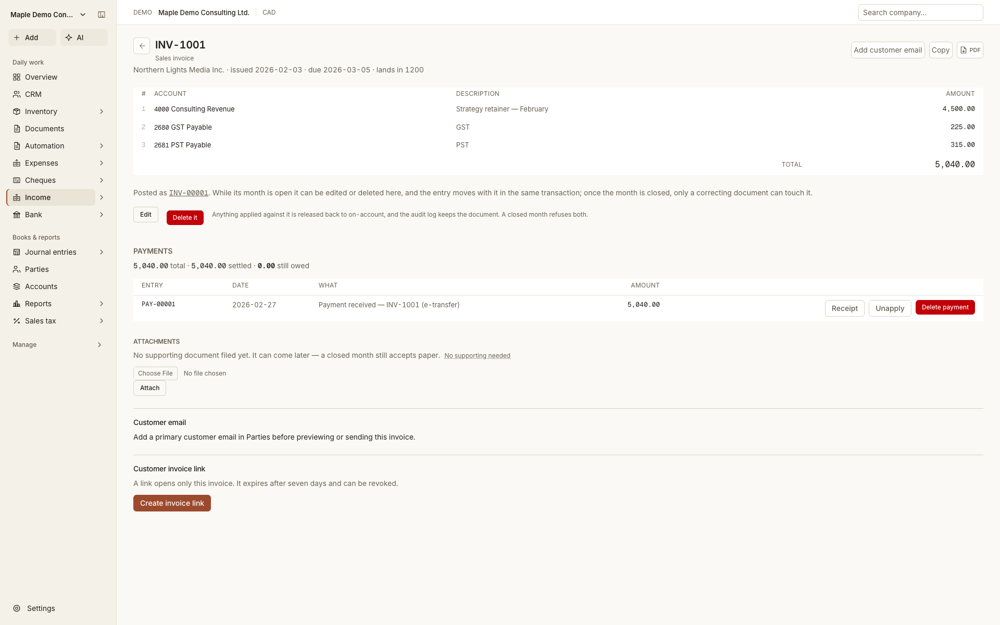
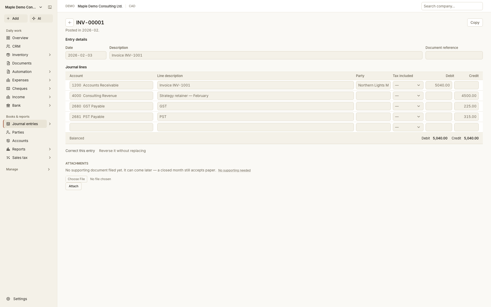

<p align="center"></p>

# Banyan

**Finance at the foundation. Clarity across your business.**

Banyan is a self-hosted finance and business management application for small businesses, with a focus on British Columbia, Canada. It starts with accounting logic: business activity, financial effects, and supporting evidence belong together.

**Version 0.0.1 · Self-hosted preview · Source available under [Elastic License 2.0](LICENSE).** ELv2 is not an OSI-approved open-source license. Published by **NSP Labs AI Inc.**



Screenshots show the real application with the fictional **Maple Demo Consulting Ltd.** and synthetic transactions. [Capture notes](docs/media/screenshots/README.md).

## Built from accounting logic upward

A sale creates revenue and a receivable. Receiving payment changes cash and what is owed. Buying equipment differs from paying an expense. Banyan connects these events through a common double-entry ledger, while keeping their business context visible.

- **Follow the transaction.** Move from invoices and payments to balanced journal entries, reports, and original documents.
- **Share financial controls.** Use accounting periods, posting checks, access permissions, and audit history across workflows.
- **Keep companies separate.** Maintain separate books and company access while reusing shared party information.
- **Add business context.** Projects, payroll, inventory, assets, documents, and company records extend the financial foundation.

Not every business record creates a posting. Each workflow controls when a financial action occurs. In particular, an invoice's **Payment in stages** section is printable text only: it does not schedule payments, create accounting records, or change aging or balances.

## From a sale to the books

Demo invoice **INV-1001** records a CAD 4,500 sale plus CAD 540 in tax. Its CAD 5,040 total is settled by a receipt. The invoice links to its posted entry and payment.



The same transaction posts **INV-00001**: debit receivables CAD 5,040, credit revenue CAD 4,500 and tax liabilities CAD 540. The accounting effect is visible rather than hidden behind the form.



<details>
<summary>Financial statements and payroll screenshots</summary>

The same ledger supplies the [financial statements](docs/media/screenshots/financial-statements.png), including the CAD 3,510 receivable also shown in Income. [Payroll](docs/media/screenshots/payroll.png) connects a synthetic pay run to its journal and CRA liability.

</details>

## What is included

| Financial foundation | Capabilities |
|---|---|
| General ledger | Accounts, balanced journals, periods and year-end, trial balance, financial statements and general-ledger reports |
| Sales and purchases | Invoices, bills, credit notes, receipts, payment allocation and aging |
| Banking | CSV import, matching and reconciliation |
| Sales tax and FX | Canadian GST/HST and BC PST working information; foreign-currency documents, settlement and revaluation in CAD-base books |
| Evidence and data | Document attachments, report exports, budgets, staged opening/historical imports, company archives and full-instance backups |
| Optional integrations | AI assistance, MCP queries and reviewed draft proposals, automation, invoice portal and external payments |

| Add-on | Capabilities |
|---|---|
| **Project** | Revenue and cost records, invoices, customer receipts, supplier payments, allocations and attachments |
| **Payroll** | Canadian federal / BC payroll calculations, pay slips, postings and T4, PD7A and ROE working information |
| **Operations** | Fixed assets, depreciation, inventory, production and accounting links |
| Records | Corporate profile, directors, securities and transparency registers, certificates and minute book |
| CRM | Leads, contacts, accounts, pipeline, tasks and activities |
| Documents / eSign | PDF versions, optional Documenso Cloud drafts and signed evidence |
| SR&ED | Research narratives, time, expenses and tax-credit working papers |

All add-on source is included. Build selection and company-level activation are separate; see [Modules](docs/MODULES.md). These modules share one application and database, rather than independently deployed services.

Receipt PDFs can append supported payment images and PDF attachments after the receipt body. Project payments linked to accounting use the same supporting attachments as Income. The Outlook mailbox prototype is not part of this release.

## Quick start

Use **Node.js 26**, npm, and **PostgreSQL 17** with `psql`, `pg_dump` and `pg_restore`. Builds need internet access for npm packages and Google Fonts.

```sh
npm ci
cp .env.example .env.local
```

Create a dedicated empty PostgreSQL database named `banyan_local`. Edit `.env.local` with its `DATABASE_URL` and absolute, persistent `ATTACHMENTS_DIR` and `PROJECT_ATTACHMENTS_DIR` paths. Keep the two storage directories separate and outside the source folder.

```sh
npm run db:migrate -- --database banyan_local
npm run build
npm run start
```

Open `http://localhost:3000/first-run` to create the initial administrator, then create a company. Restrict access until initial setup is complete. For public hosting, configure HTTPS and a private reverse proxy before allowing access.

Read the full [installation guide](docs/INSTALL.md), [backup guide](docs/BACKUP.md) and [known limitations](docs/KNOWN-LIMITATIONS.md) before using business data. This is an early preview; tax and payroll outputs need professional review for your circumstances.

## Documentation

- [Install and operate](docs/INSTALL.md)
- [Backup and recovery](docs/BACKUP.md)
- [Modules](docs/MODULES.md)
- [Integrations and data boundaries](docs/INTEGRATIONS.md)
- [Development and verification](docs/DEVELOPMENT.md)
- [Known limitations and release checks](docs/KNOWN-LIMITATIONS.md)
- [Source provenance and compatibility](docs/PROVENANCE.md)
- [Changelog](CHANGELOG.md), [security reporting](SECURITY.md), [contributing](CONTRIBUTING.md)
- [License](LICENSE), [notice](NOTICE), [third-party notices](THIRD-PARTY-NOTICES.md)

## License

First-party code is available under **Elastic License 2.0**, subject to its restrictions. Separate authorization is required for commercial hosting under the publisher's licensing policy; no commercial hosting agreement is included in this package. Consult the actual license text for the grant and restrictions. Third-party dependencies and notices retain their respective licenses.

Banyan 0.0.1 is derived from FigTree. Some internal identifiers deliberately retain the FigTree name for backup, audit, credential and database compatibility. See [Provenance](docs/PROVENANCE.md).
